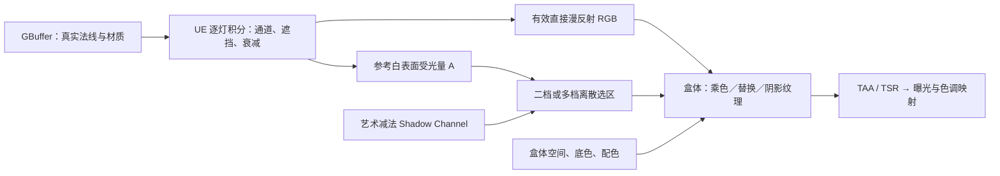

# 盒体漫反射映射：当前设计与清理边界

更新：2026-10-15。本文是当前设计入口；早期排错记录保留为历史，不再作为接口说明。

2026-10-16 增补：新增独立间接漫反射 provider 和可选调色。见 [间接漫反射第一阶段](deferred-toon-indirect-diffuse.md)。下文残差公式描述未启用独立间接调整时的兼容路径；开启后已提取的间接层从残差分出，不再由 Other Lighting Weight 控制。

## 1. 当前要实现什么

先让 UE 按每盏灯自己的位置、方向、颜色、强度、距离衰减、光照通道和遮挡计算贡献，再累加。盒体读取这一结果，决定明暗档位，并进行乘色、颜色替换或空间纹理映射。默认保留二档兼容，启用 Light Bands 后支持 2～8 个离散档位，使用方式见 [多档明暗操作说明](deferred-toon-light-bands.md)。

必须区分两个问题：

- **哪里算亮／暗**：读取不含材质底色的参考白表面受光量。
- **这块区域原本是什么颜色**：读取真实材质的遮挡后直接漫反射 RGB。

这样深色材质不会仅因底色暗而被判为阴影，真实输出仍能保留材质颜色与灯光颜色。方向光、点光源、聚光灯等进入同一延迟逐灯累加路径，不单独优待某种光源。

当前主要覆盖延迟渲染、不透明场景的动态直接光。它不是把整个 UE 着色流程替换掉，也不是 Hi-Fi Rush 全部光照层的完整复刻。

## 2. 数据流与时序



自定义 RT 在当前帧照明前清零，逐灯累加；盒体在 TAA/TSR 前、主视口分辨率下采样。保留此前解决抖动、矩形残留所需的完整清理、ViewRect 处理和 Pass 顺序。**不恢复自定义 ShadowBuffer 时序历史。**

盒体只改覆盖范围内的可见表面。深度重建世界坐标，再转盒体局部空间；空间范围与光照选区是两个独立权重。盒体边界可以柔和，明暗选择仍保持离散档位。

## 3. RT 契约：哪些要保留

| 数据 | 当前含义 | 保留理由／禁止的用法 |
|---|---|---|
| `EffectiveLightBuffer.rgb` | 含真实材质响应、逐灯遮挡后的直接漫反射总和 | 当前乘色的主要颜色输入；不能再乘一次同样的底色或总遮挡 |
| `EffectiveLightBuffer.a` | 单位白色参考漫反射响应的亮度总和 | 当前唯一物理受光选区输入；不是 N·L、不是 0～1 阴影概率 |
| `LightingBuffer.rgb` | 未遮挡的直接漫反射，包含真实材质响应 | 对照诊断、艺术层和后续光照损失分析；不能直接替代参考白表面数据 |
| `LightingBuffer.a` | 专用 Shadow Channel 减法量 | 艺术控制的独立输入；不是普通光源的遮挡再累加 |
| `ShadowBuffer.r` | 各灯导出的原生遮挡累积，查看时饱和 | 通道诊断和后续艺术工具；没有每盏灯的能量权重，不能决定最终多灯暗区 |
| `SpecularBuffer.rgb` | 未遮挡的直接高光 | 后续高光风格化的已有输入；不是完整环境反射，也不能当最终遮挡后高光层直接合成 |
| `SpecularBuffer.a` | 合格灯的最大正 N·L | 保留朝向诊断和艺术输入；不再驱动生产明暗选区 |
| GBuffer / 深度 / AO / 速度 | 已有材质与几何输入 | 底色调制、世界坐标、后续材质分组、AO 与运动相关扩展 |
| 原始 SceneColor | 进入盒体系统前的场景颜色 | 当前保留其他贡献的过渡来源；不把它称为干净的 GI 或反射层 |
| `ToonIndirectDiffuse.rgb / a` | Lumen 或非 Lumen 动态天光的实际间接漫反射 / 像素可用性 | 独立间接调色输入；只 RGB 预曝光，不驱动直接光分档。支持范围和残差扣除限制见独立文档 |

RT 名称含 ShadowBuffer 不表示它是 UE 原生公共 RT：这里的 Lighting/Shadow/Specular/Effective 缓冲均为项目增加的导出目标，数据来自原生或自定义光照计算。

有效 RT 为 `PF_FloatRGBA`。RGB 和 A 均乘过预曝光；盒体先乘 `OneOverPreExposure` 恢复场景线性值，输出时再乘一次 `PreExposure`。这是数值空间转换，不是取消 UE 最终曝光。**选区不随显示曝光变化，但随真实灯光强度和颜色变化。**

Alpha 的参考积分使用白色非金属、无镜面反射的固定参考材质，保留真实法线、光源与可见性；不是把材质漫反射除以 BaseColor。它有额外逐灯积分成本。新增 RGBA16F RT 在 1920×1080 下约 15.8 MiB，尚未做本场景 GPU 性能定量优化。

## 4. 明暗如何计算

下列公式是未启用 Light Bands 时的二档兼容路径；启用后改用本节后面的区间选择。

用场景线性量表示：

```text
D = sum(每盏灯经过遮挡后的真实材质漫反射 RGB)
E = sum(每盏灯经过遮挡后的参考白表面漫反射亮度)
Lit = E > 0 且 E >= EffectiveLightThreshold ? 1 : 0
A = saturate(艺术减法 Shadow Channel)
ShadowSelection = 1 - Lit * (1 - A)
BinaryShadow = step(ArtisticShadowThreshold, ShadowSelection)
```

`Artistic Shadow Threshold` 沿用底层属性名 `ToonShadowThreshold`，范围 0.001～1。物理暗区已经是 0/1，它主要决定艺术减法层何时强制归入暗区。`Effective Light Threshold` 默认 0.1，没有上限 1 的假设；即使阈值为 0，零受光仍为暗。

多光源示例：方向光提供 1.0，点光源原本提供 0.2。点光源被挡住后剩余受光仍是 1.0；阈值 0.1 时仍属于亮区。不能因为“其中一盏灯有投影”而强制把它涂成暗区。

普通阴影接收通道在逐灯原生可见性阶段生效；盒体不重新凭全局阴影并集推断。艺术减法光仍然允许人为增加暗区，这是明确保留的非物理控制。

### 多档区间选择

启用 `Use Light Bands` 且存在至少两条配置时，将前 8 条配置按 `Min Response` 稳定排序，第一档下限固定为 0。总参考受光量 E 选择下限不大于 E 的最高档，正好等于分界时进入更高一档；重复下限以后出现的条目为准。E 为 0 或艺术减法量达到 `Artistic Shadow Threshold` 时，强制选择排序后的第一档。

每档的 `Value` 是 0～1 的离散输出值／颜色曲线坐标，不是受光阈值。第一档颜色由作者决定，程序不根据其 RGB 重新判断亮度。四档预设下限 `[0,0.1,0.4,1]`，输出 `[0,0.3,0.6,1]`。程序不自动根据画面最大值归一化，避免相机变化使档位漂移。

Debug 14/19/20 保留二档参考语义；启用多档后用 **Debug 24** 查看实际档位。当前多档只用于 Direct Light Grade / Toon Recompose，辅助 Scene Color Tint 保持二档政策。

## 5. 颜色和纹理如何输出

本节的亮／暗双端点公式描述二档兼容路径。启用多档时，使用下述通用形式：

```text
档位目标色 C = 独立 Override Color，或 Light Band Color Curve(Value)，或 lerp(暗端点, 亮端点, Value)
档位 Replace 权重 = lerp(Shadow Color Replace Weight, Lit Color Replace Weight, Value)
按该档 Shadow Mapping Weight 将 3D / 2D 阴影纹理混入 C
Direct Light Grade = lerp(D * C, C * B, 档位 Replace 权重) * PreExposure + 剩余贡献
Toon Recompose = C * B * PreExposure
```

颜色曲线只在代理更新时按离散档位值采样，每个区间内目标色固定，没有连续明暗插值。三平面纹理与原生乘色仍可能在档位内部变化；两端 Replace Weight 均为 1 时所有档位均为替换色。色板曲线变化会更新代理，无需重编译 shader。

亮区颜色 `Cl` 来自 `Lighting Color Curve` 的时间 1 端点；暗区基础颜色 `Cs` 来自 `Shadow Color Curve` 的时间 1 端点。当前两个主要输出模式只使用端点，不按受光量在整条颜色曲线上连续游走。

暗区目标色的顺序：

1. 暗区曲线端点。
2. 按 `Shadow Color Volume Weight` 混入盒体局部 3D 颜色纹理。
3. 按 `Shadow Texture Weight × Texture Alpha` 混入 2D 阴影纹理 RGB。

2D 纹理采用盒体局部三平面投影，Tiling 与 Offset 控制各投影的重复和位移；3D 纹理直接采样盒体归一化 XYZ。三平面权重来自局部几何导数。它们都是空间映射，不是屏幕贴图；物体经过固定盒体时会穿过该空间纹理。

### Direct Light Grade：保留原生漫反射并调色

```text
B = lerp(1, GBuffer.BaseColor, BaseColorWeight)
LitColor  = lerp(D * Cl, Cl * B, LitColorReplaceWeight)
DarkColor = lerp(D * Cs, Cs * B, ShadowColorReplaceWeight)
GradedDirect = lerp(LitColor, DarkColor, BinaryShadow)
Residual = max(OriginalSceneColor - D * PreExposure, 0)
Output = GradedDirect * PreExposure + Residual * OtherLightingWeight
```

乘色权重为 0 时保留直接光内的原生渐变、软投影与灯色；替换权重为 1 时使用艺术颜色，可以把完全无光的暗部染成紫色等指定颜色。BaseColor 只调制替换色／纹理，不再重复乘到已经含材质响应的 D 上。

**为什么一部分投影仍是灰色？** 该处失去了一盏灯的贡献，所以 D 下降，但其他灯使 E 仍高于阈值。它仍属亮区，乘色模式会保留这部分亮度差，因此不会使用暗区紫色。这是当前选区与着色政策的结果，不是 RT 丢失。

`Other Lighting Weight` 默认 1；设 0 可隔离加工后的直接层。Residual 只是场景差值的非负部分，SSS、雾、复杂组合和减法贡献不保证能被这样精确拆层；保留它是过渡方案。多个盒体统一使用进入系统前的原始 SceneColor 计算残差，避免重复扣除。

### Toon Recompose：固定两档颜色

```text
Output = lerp(Cl, Cs, BinaryShadow) * B * PreExposure
```

不保留原生直接光区内渐变，也不添加其他光照残差。若希望明暗内部都是固定颜色，使用此模式；也可将 Direct Light Grade 的两个 Replace Weight 均设 1、Other Lighting Weight 设 0。纹理、底色、盒体边缘混合、最终抗锯齿仍会增加颜色变化，不能将“严格二分选区”误称为最终屏幕只有两种 RGB。

### 保留的辅助输出

- `Scene Color Tint (Advanced)`：旧 `NativeComposite=0`，整体场景乘色。保留 LightingColorCurve 的旧强度 LUT 行为，暗区改用同一有效二分选区和统一暗部纹理色。它不等于独立漫反射映射。
- `Style Layers Preview`：旧 `Replace=2`，用于验证配表中的语义输入和运算。并非把整份 Style Profile 自动接入 Direct Light Grade。

所有输出最后按盒体范围、Falloff、BlendWeight 混合回当前场景。输出编号不重排。构造默认仍保留旧值 0，避免旧资产省略默认值后被静默重新解释；使用当前漫反射流程时明确选择 4 或 3。

## 6. 本次删除、兼容与保留清单

| 项目 | 处理 | 原因 |
|---|---|---|
| 旧最大 N·L 阈值＋总遮挡并集选区 | 删除运行分支与 GPU/代理参数 | 丢失灯与遮挡对应关系，与有效光路径重复 |
| `DirectLightMaskSoftness` | 删除运行参数和编辑入口 | 严格二分中已无实际作用 |
| `Use Effective Lighting` 开关 | 删除编辑入口和运行切换 | 不再支持切回错误的多灯选区 |
| 上述旧属性／Setter | 仅保留弃用兼容壳 | 旧序列化字段与蓝图引用可读取／调用，但不再影响渲染，也不自动把 0～1 角度阈值迁成光能阈值 |
| `RecomposeDiffuse=1` | 删除 HLSL 算法，隐藏枚举；加载、Setter、代理统一迁至 4 | 旧方案重复乘底色并借用非物理总遮挡 |
| 旧阴影颜色 LUT、分源混色与重复 Union 中间量 | 删除代理、上传和 HLSL 冗余 | 当前使用统一暗区目标色与同一最终选择量 |
| 固定 RT 测试层堆栈、KeepAlive、按层索引取基础材质 | 删除 | 基础输入不应依赖用户配表顺序；空配表就是空配表 |
| Style Profile／Inline Layers、运算与注册表 | 保留并修正 Channel 选择 | 后续可配置着色的已有基础；现在只在 Preview/相关调试时求值 |
| Debug 15/16 | 隐藏重复选项，保留数字兼容 | 分别与 5/6 相同 |
| 朝向、高光、未遮挡漫反射、遮挡 RT | 保留 | 有独立语义、调试价值和后续层处理用途；不能因当前主输出不用就删除 |
| 历史排错记录、截图、测试工程资产 | 不删除、不批量重存 | 便于回溯；本次不做用户内容清理 |

修改均在相关源码处以 `[DeferredToon]` 注释标记。移除代码前的局部副本放在工作区 `outputs/diffuse-cleanup-before`；这些是整理前快照，不代替 Git 提交。

## 7. 配表与 RT 扩展约定

注册表的稳定语义 ID 与实际纹理分开；已有 ID 不重新分配。添加 RT 时依次维护：分配／清理与逐灯写入、源绑定、语义描述符、HLSL 解码、可用性与缺失默认值、必要的调试视图。删除生产者前先检查是否仍有配表和诊断消费者。

每个盒体最多 12 个 authored layers，不等于只能注册 12 个输入。空 Profile、空 Inline Layers、`No Style Layers` 都使用中性空栈，不自动乘一遍全部 RT。基础调试、明暗选区、BaseColor 均直接读取对应输入，不依赖第几层。Channel 使用用户选择，不能被描述符默认通道覆盖。

注册表当前是语义元数据；**仅注册一个新 ID 不会自动生成 HLSL 采样代码**。现阶段仍需显式维护 shader switch。既有 DirectLight / SpecularDirectLight 语义保留预曝光空间，Effective 两个语义已解预曝光；调用配表混合不同输入时应遵守这个现存差异，后续统一必须版本化迁移，不能悄悄改变已有资产。

## 8. 当前没有实现、后续才设计的部分

- 每盏灯独立的投影染色、主光／辅光艺术优先级。
- “被补光照亮的投影也染一点阴影色”：需要能量加权的遮挡损失输入，而不是恢复总遮挡并集。可考虑导出同一参考白表面的未遮挡受光 `E0`，用 `(E0-E)/max(E0,epsilon)` 等量作为独立艺术强度；与当前二分区域分开设计。现有含材质的 LightingBuffer RGB 不能直接充当无材质的 E0。
- 干净的 GI、环境反射、遮挡后高光、自发光分层及各自合成政策。
- 完整材质节点图／用户 HLSL 编辑器、可烘焙查找表，以及包含当前所有盒体参数的统一风格资产。目前 Style Profile 只是语义输入运算列表。
- 对 Hair/Substrate、雾、SSS、透明对象、烘焙光的专项集成与性能优化。

这些后续目标不作为理由保留错误的旧选区算法，也不在本次清理中擅自新增着色效果。

## 9. 调试与验收

建议顺序：22 有效漫反射 RGB → 23 参考受光量 → 14 亮区二分 → 20 最终暗区二分 → 0 所选输出。

5 原生遮挡、6 艺术减法、17 二者诊断并集、21 原始 N·L 用于解释输入，不能把它们当作实际最终暗区。23 的显示使用 `E/(1+E)` 压缩，供观察，不是直接显示阈值数值。

验收覆盖：方向光单独、点光源加入／移除、黑白材质切换、预曝光切换、阴影接收通道不匹配、2D 阴影纹理；新增配表重排不改变基础底色或 ToonRecompose、Preview 中用户 Channel 生效的检查。测试仅在独立离屏进程临时修改，不保存工程资产。

2026-10-15 验证结果：

- UnrealEditor Win64 Development 编译成功，包含 UHT 与 Engine/Renderer 重新链接；`diffuse-cleanup-build.log`。
- 99 项静态契约／数值行为回归通过；`diffuse-cleanup-tests.log`。数值用例包含总受光单调性、零阈值、艺术减法、材质／曝光隔离、区内乘色渐变与替换、底色不重复相乘。
- D3D12/SM6 离屏渲染 21 阶段完成，正常退出；`diffuse-cleanup-d3d12-final.log` 中有 `DIFFUSE_CLEANUP_GPU_PASS`，无新 shader/PSO 致命错误。
- 图像检查通过；`diffuse-cleanup-image-check.log`。加入点光后出现约 2.3 万个该灯的额外原生遮挡像素，最终二分仅有 18 个新增边缘像素；没有恢复阴影并集盖暗问题。
- 黑白材质、预曝光切换的参考受光平均图像误差分别约 0.132、0.133（8 位显示值）；通道不匹配的原生遮挡像素为 0。
- 改变 Style 层后，基础底色和 ToonRecompose 输出平均差异分别约 0.114、0.118（8 位显示值，时序边缘容差内）；Preview 的 RGB 与 R 通道输出有预期的彩色／灰度区别。已查看纹理和通道截图。

以上日志和 `cleanup-*.png` 位于工作区 `C:/Users/ASUS/Documents/Codex/2026-10-02/qin/outputs`。首次通道截图测试因 Python 数组元素的结构体副本未写回而失败，改为显式构造并写入新结构体后重跑通过；未为通过测试而修改通道算法。SM5、Hair/Substrate 专项画面与大规模性能不在本轮验证范围内。未保存测试场景资产，未自动提交或推送 Git。
